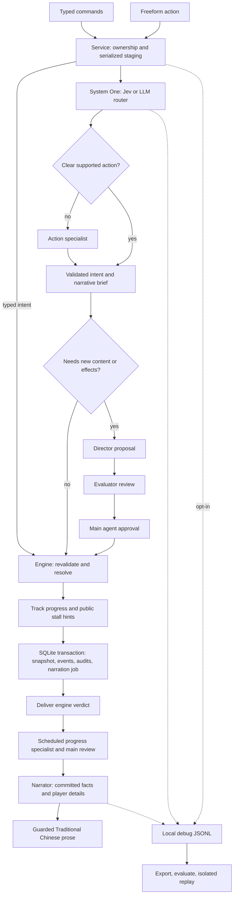

# D&D DM Bot — System One architecture (snapshot v9)

The world remains **黑暗海洋奇幻**: oppressive fog, ancient threats, real costs,
and occasional dark wit. Player creativity shapes the attempted method and the
narration; the engine determines what actually happens. `gamerules.json` is the
source of truth for tone and canon.

## Routing and specialists

`MainAgent.interpret_routed` orchestrates the bounded workflow. Specialists return
data; they cannot delegate to one another, access the service, write game state,
or send messages. The `main` model reviews proposals and progress guidance;
routine existing actions need no main-model call.

| Component | Responsibility |
|---|---|
| `DecisionGateway` / `router` | Batched category, target, destination, ambiguity, detail, improvisation, help, compound and linked-action decisions |
| `action` | Interpret open-ended methods, references, arguments, and uncertain routes |
| Deterministic memory | Retrieve bounded engine facts with event references |
| `director` | Propose adjacent scenes, inert props, or bounded improvisation |
| `evaluator` | Review player intent, canon, coherence, and costs |
| `main` | Approve proposals and select evidence-based guidance |
| `progress` | Assess public objectives, repetition, and options after commit |
| `narrator` | Describe committed results while responding to player details |

Native **TypeSafe Jev**, a System One decision model, is separate from the older
**Judge–Evaluate–Verify** director workflow. Jev never determines dice outcomes
or mechanical legality. `/v1/systemone` receives batched typed choice questions.
Answers must include exactly the known options, finite probability distributions
summing to one, and a selected maximum. Missing confidence disables the direct path.

The direct path requires probability ≥ 0.85 and confidence ≥ 0.8 for all relevant
decisions by default. It conservatively supports attack, move, search, observe,
defend, escape, rest, and pass. Existing destinations and targets must agree with
deterministic parsing when available. Attack details needing method interpretation
go through the action specialist.

Without a TypeSafe key, or after one failed native request, `roles.router` uses
the configured LLM. Its self-reported confidence is uncalibrated: direct routing
additionally requires a complete deterministic parse. Both requests consume the
shared budget. There are no retries. If interpretation also fails, only complete
deterministic actions proceed; unresolved requests require clarification. Compound
or linked requests go to the bounded action planner rather than executing a partial parse.
Before that branch, the action operator recognizes complete collection and corpse-search
requests deterministically. A mistaken compound flag cannot turn a single pickup or
item list into an attack/use plan. Requests containing restrictions, alternatives,
negation or another outcome retain semantic interpretation.

Both `backend="auto"` and `backend="jev"` prefer native Jev with a configured key
and retain LLM fallback. `backend="llm"` always selects the LLM router. Typed
commands bypass routing and action supervision; milestone progress review and
narration can still call models.

## Player details and new mechanics

### Collecting visible loot

`pickups.py` normalizes one item, a named list, or all visible ground items into
one `take` action. The engine preflights the entire collection, resolves exact
names before unique partial matches, and transfers complete existing stacks.
Missing or ambiguous items reject the whole collection before spending a turn.
Hidden items require a successful search; collections never create items. The
legacy single inert-prop director path remains available, excluding generic
collection labels and game equipment. At most 20 item types can be collected
per request; a standalone collection spends one action in combat.

Corpse searches inspect defeated encounter members in the current scene and
report existing ground loot. They never reroll death drops or XP, reveal unrelated
hidden items, or require the player to predict loot names. Cutting methods require
a held blade. Authorization, pending checks, staged persistence and replay apply
to these deterministic actions as to other engine actions.

### Linked action plans

The router distinguishes mechanical steps from dialogue/style and flags steps
serving one goal. `MainAgent._interpret_linked` assigns decomposition to the
action specialist. It returns one goal, relationship, and at most three steps.
The v1 engine vocabulary is `take`, `prepare`, then `attack` or `use`, in that
order. A pickup must supply the final item or a preparation ingredient; a
preparation must supply the final attack. Independent goals, hypotheticals,
negations, unsupported steps and silent changes of method are rejected without
executing a partial plan. Inputs are bounded to 1500 characters.

`action_plans.py` verifies exact visible ground items, actor-owned materials,
and a present target before mutation. Hidden items cannot satisfy pickups.
One explicitly requested pickup transfers one unit and is an object interaction
alongside the next action. Existing pickup/use or pickup/throw chains require
no director call. Every decomposition receives evaluator and main approval to
check that no requested method or ingredient was dropped.

Novel preparation additionally requires a director template, evaluator and main
approval. The only v1 template is `improvised_throw`: one or two player-specified
materials (one unit each), an SRD skill, and easy/moderate/hard engine DC. Crafting
spends one action and consumes the ingredients on either outcome. In combat the
engine rolls and advances the normal action slot; outside combat it preserves
the existing `/roll d20` flow. Success creates a registered single-use projectile;
failure creates nothing and ends the plan. There are no numeric model-defined
damage, poison, area, healing or reward effects.

Crafting always stops before the attack. `/confirm` (when no ordinary confirmation
is pending) or `/plan resume` rechecks ownership, actor health, original scene,
target, item possession and combat slot before the next action. Throwing uses
the standard DEX-vs-AC attack and `1d4` damage, with existing NPC hostility,
death, loot and XP handling. Prepared projectiles are consumed on hit or miss.
Missing conditions pause the plan with a concrete reason; there is no fallback
to a normal attack. `/plan status` is read-only; `/plan cancel` cancels remaining
steps and its own pending craft check without refunds. `/continue` only resumes
narration or shows guidance; it never executes plan steps.

Plans and prepared-item registrations live in the staged game snapshot. Every
step and stop reason is recorded with a plan ID, while model proposals/reviews
remain operator audits. Debug capture and offline replay include plan creation,
roll settlement, status, cancellation and explicit continuation. No additional
payload fields are sent to TypeSafe; actor inventory and ground-item details
are supplied only to the configured planning specialists. The creative call
budget remains eight, including routing fallback and narration.

### Narration and individual improvisations

`NarrativeBrief` stores original words, attempted action, and creative details
separately from canonical facts. It travels with the saved narration job and
pending check, so `/roll` and `/continue` preserve the original idea. The narrator
is told this describes an attempt; only engine facts establish success and costs.

Ordinary actions retain ordinary engine resolution. Novel mechanics require a
director proposal, schema checks, evaluator approval, main approval, and engine
verification against the current revision. Each improvisation uses one of the 18
canonical skills and an engine-owned DC: easy 10, moderate 14, or hard 18. Models
cannot supply numeric damage, DCs, quantities, or executable effects.

| Effect | Engine constraint |
|---|---|
| `damage` | Living current enemy; `1d4`; existing death, loot, and XP handlers |
| `heal` | Party member; owned 治療藥水 consumed; `2d4+2` |
| `advantage` | Next attack against the selected enemy gains advantage |
| `cover` | Attacks against the party target have disadvantage until that member next acts |
| `npc_reaction` | Present NPC disposition moves one step; success softens, failure increases suspicion |
| `prop` | Existing inert-item verifier; no valuable or mechanically significant items |
| `scene` | Existing scene verifier; adjacent route, no movement or combat escape |
| `reward` | `salvage` = one 繩索; once per scene across the whole party |

Plans allow at most two success effects, one failure reaction, two distinct
owned-item costs, and one major effect (damage, healing, reward, or scene).
Costs are paid when the attempt begins. Exploration checks can wait for `/roll`;
combat checks resolve immediately and consume the normal action slot. Saved plans
are revalidated on settlement; changed scene, targets, or reward availability
cancel effects. Pending checks clear after settlement, preventing repeat effects.

New scene extensions and generated search props also receive evaluator and main
approval in routed mode. Rejected scene extensions leave the world unchanged.
A rejected optional search prop can still leave an ordinary search available
under the existing engine rules.

## Budgets and hints

Ordinary commands use `[supervision].max_calls` (default 6, configurable 4–6).
Creative proposals and scene extensions use `[routing].creative_max_calls`
(default 8, configurable 6–8). Failures, fallback, reviews, progress, and narration
all count. Required reviews and narration reserve slots; progress can defer to a
later command or `/continue`. Main-model calls remain limited to three per command.

Stall detection compares meaningful state changes rather than turn numbers or
prose. Rejected attempts count. Rest, observation, meta/table talk, and combat
rounds do not count as stalled exploration. A `/roll` that changes state resets
the counter without counting an extra attempt.

Guidance appears after three stalled attempts, with a three-attempt cooldown by
default. Explicit help bypasses cooldown. Counters persist in `operator_state`;
guidance is saved in the narration job. Hints use pending-roll instructions,
existing exits, visible NPCs, and typed combat options, without revealing hidden
items, private knowledge, or future plot beats.

## State and transactions

`service.py` serializes each channel command and stages private copies. The
engine rechecks ownership, eligibility, combat slots, resources, and proposal
preconditions at execution. One SQLite transaction commits the snapshot, new
ledger events, director decisions, operator audit, and narration job before
verdict delivery. Failed writes publish no staged state.

Progress review and narration follow gameplay commit. Output/model failures
leave durable continuations; restart or `/continue` resumes prose without
rerouting or resolving the action. Audit reports are separate from canonical
facts. Narration and rejected proposals do not become factual memory.

Snapshot v9 adds per-character linked plans and registered prepared items;
v8 introduced the party-shared improvisation reward allowance.
The codec still loads v4–v8 snapshots, pending checks, and confirmations.
Database schema v2 is unchanged. `DATA_DIR/campaigns.db` remains authoritative;
legacy JSON files remain read-only migration checkpoints.

`[routing].enabled=false` restores the previous supervised workflow in this
version. `[supervision].enabled=false` selects the legacy direct workflow.
Configurations without a routing table retain their previous behavior. Disabling
routing does not downgrade v9 saves for an older binary; preserve a database
backup before deploying.

`agents.example.toml` is the public configuration template. Copy it to the
gitignored `agents.toml` for local settings. Credentials belong in environment
variables or the ignored `.env`; TOML references their names with `api_key_env`.

## Debug capture and offline evaluation

`LOG_LEVEL=DEBUG` enables bounded operational diagnostics. Separately,
`AI_DEBUG_CAPTURE=full` enables local traces under `DATA_DIR/debug`, off by default.
They record arguments, pre-state, nonsecret configuration, model request bodies
and content responses, choices/probabilities, validation failures, commits,
delivered text, final output, usage, and latency. HTTP headers and provider
reasoning are excluded. Known keys and the Discord token are redacted before JSON
serialization.

Local artifacts include player text, identifiers, and internal campaign state,
including hidden facts needed for replay. They are separate from native Jev's
public payload. Files rotate at 25 MiB, with seven-day retention and a 250 MiB
cap enforced on writes. File creation requests mode 0600; Windows ACLs still
govern access. Capture I/O failures do not interrupt gameplay. Oversized or
interrupted traces can be incomplete and are rejected for replay.

`core.trace_eval` exports JSONL, computes routing/call/latency/clarification metrics,
incorporates human labels, and replays responses using `httpx.MockTransport` in a
temporary SQLite database. It compares request bodies, output, snapshots, and
recorded call consumption without live provider requests or campaign writes.
Redaction can prevent exact replay; mismatches remain visible. See
[AI evaluation](docs/ai-evaluation.md) for commands and improvement priorities.

Native Jev receives only bounded player action text (1,500 characters), public
scene description (500), visible targets, existing exits, and a recent public
NPC exchange (500). Account IDs, inventory, hidden items, private knowledge,
unpublished plot, and campaign snapshots are excluded. Native routing runs only
when enabled and a TypeSafe key is configured. Other LLM specialists use their
configured providers and role-specific context.
