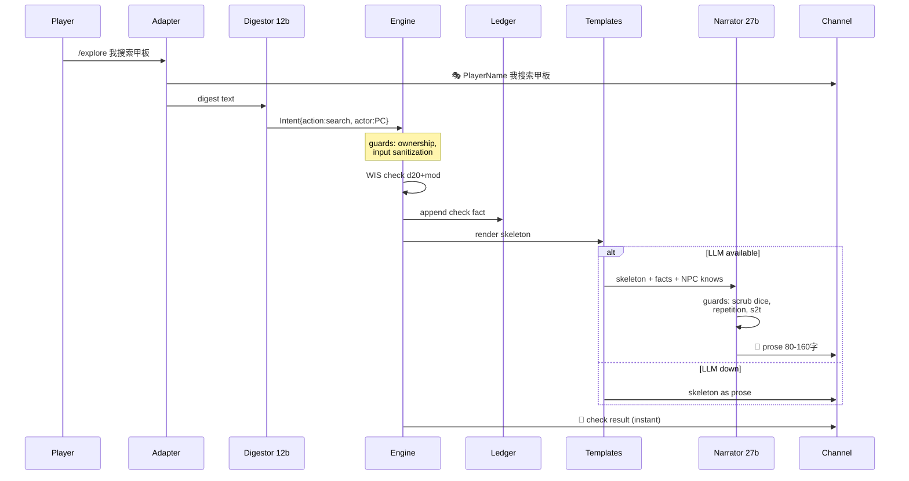
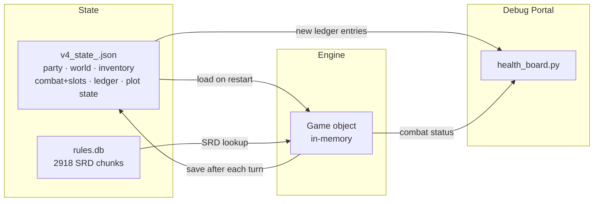

# D&D DM Bot — Architecture (v6)

```mermaid
graph TB
    subgraph "Discord Channel"
        P[Player<br/>/explore /attack /use /skill<br/>/defend /flee /observe /roll /rules]
        TP[Table Talk<br/>plain text - ignored]
    end

    subgraph "Adapter Layer"
        AD[discord_bot.py<br/>26 commands<br/>typed combat family + admin]
    end

    subgraph "LLM Periphery 30%"
        DG[Digestor<br/>qwen2.5:7b<br/>text → Intent JSON]
        NR[Narrator<br/>qwen3.5:35b (think off)<br/>skeletons → streamed prose]
        DR[Director<br/>qwen2.5:7b<br/>unplanned scenes/items → typed JSON]
    end

    subgraph "Game Engine 70%"
        RC[rules_core.py<br/>validate + resolve<br/>ONLY write path]
        TU[turn.py<br/>Game state<br/>party · combat · inventory]
        WO[world.py<br/>Scene graph<br/>NPCs + knows + encounters]
        LD[Ledger<br/>append-only facts<br/>replayable]
    end

    subgraph "Shared Math no LLM"
        CL[charlib.py<br/>AC · PB · slots]
        DC[dice.py<br/>roll expressions]
        CK[checks.py<br/>total modifiers]
        MV[moves.py<br/>class move tables]
    end

    subgraph "Guards v3 lessons"
        G1[Placeholder names<br/>PC1 PC2 mapping]
        G2[Fake-dice scrub<br/>regex families]
        G3[Repetition guard<br/>SequenceMatcher]
        G4[s2t + language check<br/>Traditional Chinese]
        G5[Input sanitization<br/>injection defense]
        G6[Ownership check<br/>user_id → owner_id]
    end

    subgraph "Output"
        TM[templates.py<br/>prose skeletons<br/>deterministic]
        HP[health_board.py<br/>debug portal<br/>log stream]
    end

    P -->|slash command| AD
    TP -->|plain text| AD
    AD -->|freeform text| DG
    AD -->|typed family<br/>structured intent| RC
    DG -->|Intent JSON| RC

    RC --> TU
    RC --> WO
    RC -->|facts| LD

    TU --> CL
    TU --> MV
    RC --> DC
    RC --> CK

    RC -->|before narrator| G1
    RC -->|before narrator| G5
    RC -->|before narrator| G6
    LD -->|skeleton hints| TM
    TM -->|with guards| NR
    NR -->|after| G2
    NR -->|after| G3
    NR -->|after| G4
    NR -->|prose| AD
    TM -->|fallback prose| AD

    LD -->|new entries| HP

    style RC fill:#4a9,color:#fff
    style TU fill:#4a9,color:#fff
    style WO fill:#4a9,color:#fff
    style LD fill:#4a9,color:#fff
    style DG fill:#f84,color:#fff
    style NR fill:#f84,color:#fff
```

## Turn Flow Detail



## Data Flow



## Key Design Decisions

| Decision | Why |
|---|---|
| Engine has the only write path | LLM cannot cheat — no attack surface |
| Ledger is append-only | Full audit trail, replayable |
| Narrator gets skeletons | Fewer tokens to generate, smaller hallucination surface |
| NPC `knows` + `disclosed` lists | Narrator cannot invent quest content; the engine drips one NEW fact per successful exchange and players see their intel progress (`/status`, 已問出 x/y) |
| Help detection = digestor field (`wants_help`) | Intent reading by meaning is the LLM's job; keyword regex only backstops the no-LLM fallback |
| Narrator voices the engine's pick | A `reveal` fact must be spoken verbatim in dialogue — information flow stays engine-owned |
| Plain text = table talk | No accidental DM triggers from chatter |
| Typed combat family (structured intent) | Zero ambiguity, per-action autocomplete |
| Per-round action slots | Discord is not a table — nobody waits |
| Director LLM proposes, engine canonizes | Unplanned places/finds without breaking state ownership |
| Selftest with seed | Byte-identical replays for regression |
