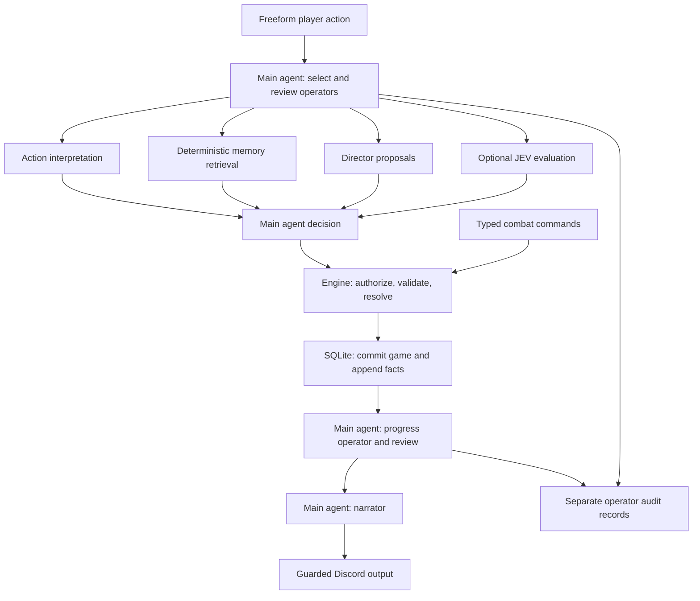

# D&D DM Bot — supervised agents and deterministic gameplay

Self-hosted Dungeon Master for Discord. A main agent coordinates action
interpretation, memory retrieval, the director, progress reviews, and narration.
The engine owns authorization, dice, rules, and every game-state mutation.
The game remains playable without models through typed commands and the CLI.

## Architecture



## Quick Start

```bash
# Python 3.11+; Ollama locally or an OpenAI-compatible endpoint
pip install -r requirements.txt
cp .env.example .env        # fill DISCORD_TOKEN and V4_CHANNEL_IDS
# Edit agents.toml for provider/model choices; credentials stay in environment.
set -a
source .env
set +a
python bot.py

# no-LLM test (proves the engine works standalone)
python core/cli.py selftest

# interactive CLI (zero LLM)
python core/cli.py
```

## Docker Compose

Requires Docker Engine with Compose v2 (or Docker Desktop). Create `.env` and
fill in `DISCORD_TOKEN` and `V4_CHANNEL_IDS`, then edit `agents.toml` for your
models and providers:

```bash
cp .env.example .env
docker compose up -d --build
docker compose logs -f bot
```

The bot runs as UID/GID `10001:10001` and needs no published ports. Credentials
are read from `.env` at runtime and excluded from the image. Any variable named
by `api_key_env` in `agents.toml` must also be present in `.env`.

`agents.toml` is excluded from the build context and image; supply it as a
runtime mount when running the image directly. Compose mounts `agents.toml`,
`gamerules.json`, and `plot.json` read-only. An
`AGENT_CONFIG` path in `.env` selects an alternative host TOML file to mount;
the container always reads it at `/app/agents.toml`. After changing mounted
configuration, run `docker compose restart bot`. After changing `.env`, run
`docker compose up -d --force-recreate bot` to reload the environment.

Set `LOG_LEVEL=DEBUG` in `.env` for detailed application diagnostics:

```bash
docker compose up -d --build --force-recreate bot
docker compose logs -f --tail=200 bot
```

Startup logs show each role's provider, endpoint, model, timeout, token budget,
and thinking setting. Command logs share a `trace` ID across routing, model
requests, operator plans, final decisions, and execution. `mode=supervised`
selects the main-agent route; model entries show which calls actually ran.
`mode=typed` uses typed engine commands;
`mode=legacy` means supervision is disabled. A main `decision: clarify` is an
LLM decision, while `status=fallback` identifies a failed request or invalid
operator response and records its reason and available deterministic candidate.
HTTP status, JSON validation location, completion reason, output length, and
thinking length help diagnose authentication, missing models, and truncation.
DEBUG also includes bounded input and structured decision previews. Configured
API keys and the Discord token are redacted; HTTP headers, full prompts, raw
error response bodies, and library wire dumps are omitted. Set `LOG_LEVEL=INFO`
and recreate the container to return to normal logging.

For local Ollama, Compose defaults to `http://host.docker.internal:11434`,
including a host-gateway mapping for Linux. The host's model server must listen
on an interface reachable from containers; Linux Ollama installations may need
`OLLAMA_HOST=0.0.0.0:11434`. For a remote Ollama server, set `DOCKER_LLM_URL` in
`.env`. An explicit provider `base_url` in `agents.toml` overrides this value;
use a URL reachable from inside the container. OpenAI-compatible providers use
their configured URL and credentials in the same way as a normal installation.
Model servers and model downloads are managed separately from this Compose file.

Campaign SQLite files and per-channel overrides persist in the `campaign-data`
named volume at `/app/data`; Compose overrides `DATA_DIR` to that path. The
host's `./data` directory is not mounted automatically. To migrate existing
data into a **fresh volume before the first start**, stop the existing bot and
prepare a consistent copy of its data (including SQLite WAL files when present),
then run:

```bash
docker compose build
docker compose run --rm --no-deps --user 0 \
  --volume "$PWD/data:/import:ro" bot \
  sh -c 'cp -a /import/. /app/data/ && chown -R 10001:10001 /app/data'
docker compose up -d
```

This also imports an existing `rules.db` for `/rules` and legacy JSON saves.
Keep one running bot per campaign database. `docker compose down` preserves
the volume; `docker compose down -v` deletes its campaign data.

Run the engine self-test inside the image without logging in to Discord:

```bash
docker compose run --rm --no-deps bot python core/cli.py selftest
```

## Commands

| Player | Admin |
|---|---|
| `/pc name occupation` — create character | `/explore-admin text char` |
| `/explore <text>` — freeform action | `/attack-admin char target move` |
| `/confirm` — confirm pending action | `/use-admin char item on` |
| `/attack [target] [move]` — typed combat family | `/skill-admin char skill on` |
| `/use [item] [on]` — item / feed a DOWNED ally | `/defend-admin` `/flee-admin` |
| `/skill [skill] [on]` — 18 skills ★, context targets | `/observe-admin char target` |
| `/defend` `/flee` `/observe [target]` | `/roll-admin expr char` |
| `/inventory` — items + slots + skills + moves | `/give-admin char item qty` |
| `/roll [expr]` — dice (settles checks, auto-continues) | |
| `/give item [to]` — transfer; no recipient = set down | |
| `/status` — party + scene + disclosed intel | |
| `/scene` — current location, NPCs, exits, visible items | `/new_game` — start an unused channel |
| | `/reset_game [confirmation]` — archive and restart |
| `/rules <query>` — SRD lookup (zh aliases, no LLM) | |
| | `/inspire-admin [char]` — grant inspiration |
| `/continue` — finish unfinished narration, else unstuck | |
| `/help` | |

Every combat command has its own typed autocomplete (enemy HP,
item quantities, ★-proficient skills, downed-ally markers) — one
command per action instead of one polymorphic menu. During combat,
verdict messages carry one-tap buttons (🛡 defend · 👁 observe ·
🏃 flee · ⏭ pass); arg-ed actions stay typed commands.

**In-channel keywords** (instant, no LLM): `status` `inv` `moves` `scene`

**Plain text** = table talk (silently ignored, no reaction, no reply)

To start, a member with **Manage Server** permission runs `/new_game` in the
game channel. Each player then creates a character with `/pc`, checks `/scene`,
and describes an action with `/explore`. `/new_game` refuses to overwrite a game
that already has characters or activity. `/scene` reads engine state without
advancing a turn, calling a model, or revealing hidden items or NPC knowledge.

To restart, run `/reset_game`, then enter `reset confirm` in its `confirmation`
option. This requires Manage Server permission. It archives the old campaign and
starts at the dock with an empty party. Characters, inventories, generated scenes,
combat, plot progress, pending actions/checks, narration, and operator guidance
start fresh. Other channels and configuration files are unaffected. The previous
snapshot, event history, narration, director decisions, and operator records are
retained as JSON rows in `campaign_archives` in `data/campaigns.db`; archives are
excluded from active campaign memory. Reset and archival commit atomically, and
the channel revision continues increasing to reject stale writers. There is no
Discord archive restore command.

Normal campaigns start without demo characters. On loading an older save, the
bot removes recognizable, unowned demo entries for 依思 and 大力蕉, along with
their inventories and pending actions. Player-owned characters (including ones
with those names), custom characters, world progress, and the original event
history are preserved. Removed demo events are excluded from model memory and
progress reports. The CLI demo and engine tests still use the demo party.

At the starting dock, use `/explore 我想向老船長打聽附近的消息`.
The captain shares one new fact per successful conversation: the route to the
tavern, then a warning about its goblins. `/status` lists disclosed information.
When no new information is available, the bot says so and suggests a next action.
Existing saves missing the original captain's knowledge receive these starter
facts automatically on load; custom knowledge and prior disclosures are preserved.

For follow-up remarks, the action operator and main agent receive the same
character's recent NPC exchange from the current scene (up to three turns old).
This helps resolve references without exposing private NPC knowledge. Movement
or the NPC leaving ends that reference. Specify the NPC when the target is
unclear, for example `/explore 我向老船長說：死老嘢，講啲唔講啲`.
Untargeted character speech is displayed once; it does not create a second
narration bubble. Narration that only echoes the player's dialogue is rejected.
The initial 🎭 echo uses the Discord display name; engine dialogue uses the
player's selected, owned character name.

For a request such as `/explore 洗劫船長`, the bot asks for a method before
resolving anything. `/explore 偷偷扒竊老船長` selects a hand skill check;
`/explore 威嚇老船長` selects intimidation. These and simple descriptions such
as `/explore 我想搜索` have deterministic fallback parsing when models fail.
Skill checks do not create NPC money or award unspecified items.

`/explore 與船長決鬥` and `/explore 跟船長單挑` identify the captain as an
attack target and use ordinary combat rules, including damage and NPC hostility.
The engine supplies a default attack when no weapon or move is specified.
Negated, hypothetical, or explicitly nonlethal practice requests require further
interpretation. `/attack` with target `老船長` also works directly.

If free-form actions keep failing, the reply now distinguishes a model failure
from a request for clarification. Check `docker compose logs --tail=100 bot`
(or the bot's console) for the failing `main` or `action` role. Model logs include
the model name, a safe error category, and HTTP status. Check the corresponding
role/provider in `agents.toml`: 401/403 indicates credentials or permissions;
404 can mean an unavailable model or an incorrect API path; connection errors
and timeouts indicate the model service needs attention. Restart after editing
configuration. `/status` and typed engine commands remain available.

## The 18 Skills

All SRD skills are wired into the engine (defined in `engine/charlib.py`,
proficiency per class in `CORE_SKILLS`). Describe the action in `/explore`
— 匿埋（潛行）、嚇佢（恐嚇）、包紮（醫藥）、爬牆（運動）— or pick from
`/combat` → ✨技能 (★ = proficient). Engine effects on success:
stealth → next attack with advantage · insight → read an NPC's true
attitude · medicine → revive a downed ally · perception/investigation →
find hidden items · social skills → move NPC disposition up the ladder.
`/inventory` shows each character's full skill sheet.

## Design Principles

1. **Engine decides, model narrates** — the LLM has no write path to game
   state; it reads facts and writes prose
2. **Predict the narration** — the engine renders prose skeletons from its
   own data; the narrator only adds atmosphere
3. **NPC knowledge is data** — each NPC has a `knows` list; the narrator
   receives only the facts the engine has disclosed
4. **No LLM required** — the CLI proves the full game (combat, items,
   scenes, checks) works with zero model calls
5. **v3 lessons ported** — placeholder names, fake-dice scrubbing,
   repetition guard, language enforcement, input sanitization

## File Structure

```
gamerules.json          # single source of truth: world tone + canon +
                        # narrative constraints (injected into the
                        # narrator prompt; edit here to change the world)

core/                   # the game engine (v6)
├── intent.py           # Intent dataclass + deterministic parser
├── world.py            # Scene graph, NPCs (with knows), encounters
├── turn.py             # Game state: party, combat, inventory, slots
├── rules_core.py       # validate + resolve (the only write path)
├── ledger.py           # append-only facts with stable per-channel event IDs
├── digestor.py         # action role: freeform text → Intent JSON
├── narrator.py         # narrator role: facts + skeletons → prose
├── templates.py        # deterministic prose skeletons
├── guards.py           # output defenses (placeholders, scrubbing, s2t)
├── service.py          # serialized commands, staged turns, commit before output
├── persistence.py      # SQLite snapshots, event appends, decision audit, narration
├── state.py            # complete state codec + legacy JSON import support
├── memory.py           # bounded factual recall with event references
├── agent_config.py     # startup TOML validation and environment references
├── model_gateway.py    # shared provider APIs, streaming, budgets, audit metadata
├── operators.py        # main agent and validated specialist reports
├── director.py         # engine gate: prop/scene canonization
├── director_llm.py     # generative Director (unplanned places/finds)
├── plot.py             # plot spine: clocks + trigger-fired beats
└── cli.py              # no-LLM REPL + selftest

engine/                 # shared pure math (no LLM, no Discord)
├── charlib.py          # AC, PB, slots, save/skill proficiencies
├── dice.py             # dice expressions (4d6kh3, adv, etc.)
├── checks.py           # total modifier calculator
└── moves.py            # class move tables + compute_attack_moves

adapters/
└── discord_bot.py      # 24 slash commands (typed combat family) + routing

health/
└── health_board.py     # debug portal (log stream + /moves)

tools/                  # operational scripts
└── ingest_srd.py       # build rules.db from SRD markdown

legacy/                 # v3 code (archived, not imported)
└── tools-v3/           # v3-era tools (seed_inv, playtest, status, ...)
```

## Models and centralized configuration

`agents.toml` is loaded once when the bot starts and shared by every channel.
Use `AGENT_CONFIG=/path/to/agents.toml` for a different file. Restart after edits.
Invalid configuration fails startup with a nonzero exit status.

| Role | Default model | Responsibility |
|---|---|---|
| `main` | qwen2.5:7b-instruct | Select operators, reconcile intent, approve proposals and guidance |
| `action` | qwen2.5:7b-instruct | Interpret freeform actions with confidence |
| `progress` | qwen2.5:7b-instruct | Assess goals, stalls, and repeated actions from evidence |
| `director` | qwen2.5:7b-instruct | Propose unplanned scenes or inert props |
| `evaluator` | qwen2.5:7b-instruct | Optional relevance/consistency review for JEV |
| `narrator` | qwen3.5:35b | Render committed facts and approved guidance |

Each `[roles.<role>]` accepts `provider`, `model`, `temperature`, `max_tokens`,
and `timeout` (seconds). Ollama roles also accept `think`; OpenAI-compatible
roles accept `reasoning_effort`. Unsupported combinations are rejected.
Thinking defaults off for Ollama so small output budgets remain available for
answers. `reasoning_effort` uses `max_completion_tokens` and omits temperature.

Providers support native Ollama `/api/chat` and OpenAI-compatible
`/chat/completions`, including streaming. For a hosted narrator, add:

```toml
[providers.hosted]
api = "openai"
base_url = "https://api.openai.com/v1"
api_key_env = "OPENAI_API_KEY"
json_mode = true

# Replace the existing narrator role table with this one:
[roles.narrator]
provider = "hosted"
model = "your-provider-model-id"
max_tokens = 400
timeout = 180
```

Set `OPENAI_API_KEY` in the process environment or your untracked `.env`.
`api_key_env` names a variable; **never put credential values in TOML**. The same
option supports authenticated Ollama proxies. Set `json_mode = false` for an
endpoint that does not implement JSON response-format parameters; responses
still undergo local JSON/schema validation. OpenAI base URLs include the API
prefix (usually `/v1`).

Explicit TOML fields override legacy environment settings. Omitted base URLs
inherit `LLM_URL`; omitted models inherit `V4_DIGEST_MODEL` / `V4_NARR_MODEL`;
Ollama thinking inherits `V4_DIGEST_THINK` / `V4_NARR_THINK`; optional evaluation
inherits `V4_DIRECTOR_EVALUATE`. Code defaults apply when these are absent.
Discord token, channel IDs, and `DATA_DIR` remain environment settings.

## Main-agent control and progress

The main model selects a bounded set of action, memory, and director operators,
then reviews their reports. It can accept an existing intent or request
clarification; it cannot invent a mechanical result. For a clear movement intent
whose destination has no exit yet, the controller also schedules a Director/JEV
repair before final review, even if the initial plan omitted the Director.
When the action operator misses a movement intent, the main agent can delegate
one Director repair that returns a proposed intent and scene for review.
Operators cannot call one
another, write campaign state, or send Discord messages. The service hosts the
controller and enforces ownership, confirmation, legality, and final verification.

Every command allows at most **six model calls**, including failures, evaluation,
and narration, with at most **three main-model calls**. Optional work reserves a
final main decision and narration. There are no retries or delegation cycles.
`[supervision].max_calls` can lower the limit to 4 or 5. Typed combat bypasses
intent supervision; inventory and status remain immediate. If the main model
fails, only a deterministic parsed action can proceed; otherwise the player is
asked to clarify. Low-confidence movement, attack, and search require confirmation.

The controller schedules progress review after explicit help, a scene change,
a plot beat, combat completion, or every five accepted gameplay actions
(`progress_interval`). Simultaneous triggers coalesce. The game commits first;
the progress operator then reports to the main agent before narration. A budget
shortage or failed review preserves pending triggers for a later turn or
`/continue`, without replaying the action.

Progress reports distinguish authored objectives from inferred goals and cite
visible event IDs. They can flag stalls/repetition and recommend choices from
current public state. They cannot complete objectives, move plot clocks, grant
rewards, or add facts. Optional public authored objectives belong in `plot.json`:
`"objectives": [{"id": "route", "text": "尋找航路", "public": true}]`.
Unpublished objectives and future beats stay out of progress prompts. The main
agent selects guidance from the report; only approved choices reach narration.

`[supervision].enabled = false` retains the older direct interpretation/director
flow while still using centralized providers and the shared call budget. Legacy
Python callers using `V4Service(..., llm_url, ...)` also retain that flow unless
an enabled `AgentConfig` or gateway is supplied.

## Director decisions and campaign memory

The director uses **Judge–Evaluate–Verify (JEV)**. Ownership, action eligibility,
existing exits/discoveries, and scene limits are checked before generation.
The model proposes one scene or inert item; the engine validates its types,
limits, uniqueness, and item restrictions before staging it with the action.
Rejected actions leave no generated world objects behind.

In supervised games, **new routes and movement repairs always require JEV**
using the configured `evaluator` role, followed by main-agent approval and
engine verification. The evaluator checks the original intent, current location,
known places, obstacles, canon, and campaign memory. An unlisted destination is a
story gap to examine rather than an automatic request to rephrase.
For example, `/explore 登上船長的船` can propose a moored ship's deck connected
back to the dock, then move there only after all three checks approve it. It
does not grant the ship, move the captain, or sail away. Existing exits are reused.
Combat, pending checks, ownership, low-confidence confirmation, and scene limits
still apply. Rejected repairs explain the blocked step and retain an audit
decision; they do not advance the turn or plot. Insufficient call budgets defer
the repair without creating an unjudged scene. There is at most one repair per
command, within the six-call limit; progress review can wait for a later turn.

Set `[supervision].director_evaluate = true` (or legacy
`V4_DIRECTOR_EVALUATE=on`) to also evaluate ordinary item proposals; this optional
setting defaults to `off`. It also controls evaluation in the legacy direct
flow. Invalid, unavailable, or negative evaluations reject the proposal; no
retries occur. Existing
deterministic gameplay remains available. This is a decision workflow, not a
trained new model; narrative consistency judgments remain fallible.

The director and narrator recall up to **12 historical engine facts / 3,000
characters**, ranked by scene, referenced characters, plot relevance, and
recency. Current state takes precedence over history. Narration, table talk,
and rejected proposals never become factual memory. Hidden items and
undisclosed NPC knowledge stay out of narrator recall. Authored `world.canon`
continues to be shared background in prompts.

## Persistence and migration

`DATA_DIR/campaigns.db` (default `data/campaigns.db`) is the authoritative store.
It contains isolated channel snapshots, append-only events, director decision
records, operator audit reports, progress scheduling state, and narration status. Saves use SQLite transactions with WAL and full
synchronization. Each command stages its changes, commits the snapshot and new
events, then sends the verdict and starts narration. Narration completion is
saved separately, without rewriting the gameplay snapshot or past events.

Database schema v2 migrates v1 transactionally and preserves existing events.
Operator reports live in `operator_reports`, separate from the canonical ledger,
with trace ID, provider/model, source revision, event references, status, latency,
and call count. Stale reports are rejected before use. Audit appends share the
corresponding state transaction. Approved guidance is saved with the narration
job before streaming, and interrupted streams remain resumable. A restart uses
that guidance without invoking action operators or resolving the action again.

Snapshots include pending checks, player-bound confirmations, combat effects,
plot progress, RNG state, and continuation references. `/confirm` and `/roll`
enforce ownership. A failed write leaves committed state intact; a failed
callback or narrator leaves a resumable `/continue`. Commands serialize within
each channel, including narration, while other channels can progress. Run one
bot process per database; revision checks reject stale writers.

On first access to a channel, v4–v6 `v4_state_<channel>.json` saves (or
`v4_state.json` for an unnamed channel) import once in a transaction. Originals
are preserved and never updated; subsequent starts use SQLite. Corrupt or
unsupported saves produce an explicit error instead of a fresh campaign.
The health board reads SQLite first and still handles unimported JSON channels.

Back up the live database with SQLite's backup API or the `sqlite3` CLI:

```bash
sqlite3 data/campaigns.db '.backup /path/to/campaigns-backup.db'
```

Use that backup for recovery. Copying just the live `.db` file can omit changes
still in its WAL. Preserved JSON files are pre-migration checkpoints, not live
backups. The ledger is an audit trail; complete snapshots are required to
restore gameplay. Existing history is loaded into memory on startup, though
only new events are written on subsequent saves.

Logs report decision reasons, model latency, commit latency, appended event
counts, and recall sizes. Offline verification:

```bash
pip install -r requirements.txt pytest
python -m pytest tests/ -q
python core/cli.py selftest
```

## License

SRD content: CC-BY 4.0 (Wizards of the Coast)
Code: see LICENSE
